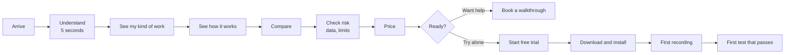

# Conxa homepage strategy

**Status:** working draft v1, 2026-11-26. Nothing here is implemented yet.
**Design concept:** https://claude.ai/artifact/9EEAYXPmu8PuP1w84QkRH4 (private; copy in `docs/artifacts/homepage-v3/`).
**How to use this file:** change it here first, then change the design. Record decisions in section 12 and add a line to the change log at the end.

**Basis:** the live site (captured 2026-11-26), the marketing code in `conxa-cloud/frontend/`, `docs/PRD.md`, `docs/TRD.md`, `docs/Security.md`, `TODO.md`, the end-to-end test records in `docs/testing/`, and a short competitor check on the web (sources in section 8). There is no customer interview or analytics data yet. Everything about what visitors think or want is a hypothesis.

---

## 0. The short version

| Question | Answer |
|---|---|
| What is Conxa, in one sentence? | You do a task once in your web apps, and your AI assistant can then do it the same way every time, on your own computer. |
| Recommended headline | **Record a task once. Your AI does it the same way every time.** |
| Who is it for? | Operations teams (main). Software companies and IT service firms that hand workflows to their customers (main). People trying it for the first time (entry). |
| What makes it different? | It follows your recorded steps instead of working them out again on each run, checks that the work happened, and can be installed on other people's computers. |
| Main button | Book a walkthrough |
| Second button | Start free for 30 days |
| Tone | Plain words first. Technical detail one click away. |

**"Show it once" is no longer enough on its own.** OpenAI (Codex Record & Replay) and Anthropic (Claude in Chrome) now let people record a task for an AI to repeat. The homepage has to lead with what happens *after* the recording: the same steps each time, checked, on your computer, ready to hand to others.

### Fix these before any redesign goes live

These are wrong or broken on the site today. Details in section 1.

1. **"Book a demo" on the homepage books nothing.** It scrolls to a video.
2. **The support email is `noreplay@conxa.in`.** It looks like a typo for a no-reply address.
3. **The privacy policy does not say that recording videos leave the computer.** Every recording is sent through Conxa Cloud to a video-analysis company. The homepage says "Your data does not go to Conxa."
4. **The self-repair picture shows a repair Conxa cannot do on its own.**
5. **The pricing page says Free is "forever".** It is a 30-day trial.

---

## 1. The current site

### 1.1 Five-second test

A first-time visitor reads: "Show it once. Any agent runs it." with three grey wireframe windows.

| A visitor needs to learn | Today |
|---|---|
| What is it? | Unclear. "It" has no meaning yet, and "agent" and "skill" are insider words. |
| Is it for me? | Not answered. No role, team or company type is named anywhere on the page. |
| What does it look like? | Not shown. No real product screen on the whole page. |
| Why not use what I have? | Three crossed-out words (Scripts, Integrations, Guessing agents). No real comparison. |
| What do I do next? | "Book a demo", which does not book a demo. |

### 1.2 What works and should be kept

- The four-step story (record, compile, publish, run) is a good skeleton.
- The "your machine / Conxa cloud" diagram is the right idea. It needs to be accurate.
- "Pay for reach, not for runs" is a clear, true pricing idea.
- The dark, restrained visual style fits the brand rules in `conxa-cloud/frontend/DESIGN.md`.
- Examples that cross several apps (onboarding, invoices, reporting) are the right shape.

### 1.3 Problems, by severity

| # | Severity | Problem | Evidence | Fix |
|---|---|---|---|---|
| 1 | Critical | "Book a demo" links to `#demo` (the video). No booking tool exists. | `HomeHero.tsx`, `HomeCta.tsx`, live site | Add a real booking link. |
| 2 | Critical | Support and security contact is `noreplay@conxa.in`. | `publicDocs.ts` `SUPPORT_EMAIL` | Use a monitored address such as `support@`. |
| 3 | Critical | Privacy text says recordings "stay on your machine". In fact each recording video is uploaded and processed by TwelveLabs. The policy names neither. | `docs/Security.md` SG-21, `publicDocs.ts` privacy page | Update policy and customer terms before pilots. |
| 4 | Critical | "Your data does not go to Conxa" and the diagram placing "Compiling" only on your machine are not true for building. | Same as above; compile also uses cloud AI | Say what leaves, and when (section 6, security). |
| 5 | High | The self-repair picture: "Submit" becomes "Send", moves across the screen, and is "found by position" with no AI. A renamed and moved button needs AI help or the run stops. | `TODO.md` EXEC-28, `docs/TRD.md` §10.1 | Replace with the honest three-step ladder. |
| 6 | High | "Across any software" and "Any agent". It works with web apps only, and with assistants that support local MCP tools only. Windows is never mentioned on the homepage. | `docs/PRD.md` §6, runtime code | Say "web apps", "your AI assistant (MCP)", "Windows". |
| 7 | High | "Free / forever" on the pricing page. The backend ends it after 30 days. | `entitlements.py` `trial_days: 30` | "Free for 30 days". |
| 8 | High | No audience, no use cases you can picture, no product screens, no comparison. | Live site | This strategy. |
| 9 | Medium | Starter shows 2M AI credits. The backend gives 2.5M. | `PricingTable.tsx` vs `entitlements.py` | Match them. |
| 10 | Medium | "Free runs on a Conxa-hosted open model" and "Starter and Pro compile on premium models". The sample production settings use an outside provider for Free, and the same model for Starter as for Free. | `.env.prod.example` | Check the live settings, then correct or remove. |
| 11 | Medium | "Ship it to your customers under your own name." Removing Conxa branding is Enterprise only. Installers are not code-signed, so Windows warns the customer. | `PLAN_LIMITS`, `TODO.md` UPD-2 | Say what each plan allows. |
| 12 | Medium | Pricing FAQ says elements are matched by "how it looks", and that Conxa receives "no personal data". Run reports include the computer name and Windows user name. | `Faq.tsx`, `server.js` runtime registration | Rewrite from section 9 below. |
| 13 | Low | Published product captures show the old Build Studio. Some originals show a workspace ID and a local folder path. | `marketing-src/screenshots/` | Capture the current app with demo data. |

---

## 2. What Conxa can truthfully say today

This table is the guardrail. **If a sentence on the page is not backed here, it does not ship.**

"Tested" means it passed the end-to-end campaign in `docs/testing/`. Much of that campaign used local practice pages and mock sign-in. The go/no-go run (WF-21) recommended a **conditional go for a free-trial pilot only**: a clean customer computer, live payments and live sign-in were not verified.

### 2.1 Safe to say

| Say | Basis |
|---|---|
| Record a task in your web apps, across several apps and tabs. | Tested (WF-1, WF-4) |
| Conxa asks plain questions: what changes each run, what to do at a popup, what cannot be undone. Every question must be answered. | Tested (WF-5) |
| Test before you share. The test pauses before steps that cannot be undone. | Tested (WF-5) |
| When a test fails, Conxa explains why in plain words and proposes one fix. You decide. | Tested (WF-12) |
| Give it a list and it repeats the entry for each row. | Tested (WF-11) |
| Downloads files and uploads them elsewhere. | Tested (WF-14, WF-5) |
| It can be set to act only on the row for the item you asked about. | Tested (WF-7) |
| For important steps it looks for proof, and says so when it cannot confirm. | Tested (WF-6). Some checks still open (PROOF-1). |
| It can pause and hand you the browser. | Tested on a stand-in page (WF-18) |
| Ask your assistant for a preview that does everything except the step that can't be undone. | Built (`docs/TRD.md` §9.7) |
| Run from your AI assistant, or from the Conxa Execute app with a form or chat. | Tested (WF-16, WF-19) with test clients and mock sign-in |
| Run on a schedule on your own computer, with no chat app open. | Built and checked once (PROD-5). Re-check before featuring it. |
| Publish versions, release them, roll back, and see run results on a dashboard. | Built |
| Saved sign-ins are encrypted on your computer and never packaged into a workflow. | Built and enforced |
| Installed workflows keep running if Conxa Cloud is down or a trial ends. | By design in code |
| Installs without administrator rights. | `docs/App-Flow.md` §9 |
| No charge per run. | Pricing model |

### 2.2 Say only with the limit attached

| Topic | The limit to state |
|---|---|
| "Repairs itself" | Small problems are fixed automatically with no AI. A moved or renamed button needs your AI assistant to pick it, and Conxa checks the pick. Scheduled runs and Conxa Execute form runs have no assistant to ask, so they stop. Fixes are not saved back into the workflow. |
| "Runs on your computer" | True when it runs. Building uses cloud AI, including a copy of the recording video. |
| "Works with MCP assistants" | The installer sets up many assistants. Claude Desktop has been used live. Check each one before showing its logo. |
| "Share with customers" | Works as an installer. Windows will warn "unknown publisher" until installers are signed. White-label is Enterprise only. |
| "Agent steps" | An author can add a step where the AI decides. Everything else follows the recording. |

### 2.3 Do not say

"No data goes outside" for the Enterprise own-key option: it covers the compile AI calls only (they still pass through Conxa Cloud), while the recording video and run reports still leave. Mac or Linux. Desktop programs, Citrix, mainframes. Canvas apps. Drag and drop. Solving CAPTCHAs or one-time codes. SOC 2, ISO 27001, HIPAA. Single sign-on (SAML) for the Conxa dashboard. Approval workflows enforced by policy. Signed installers or signed workflow packages. "Learns and gets better by itself." "Works with ChatGPT." "Any website", "any agent", "never fails", "never leaves your machine" (without "when it runs"). Customer logos, quotes or usage numbers (we have none).

---

## 3. Positioning and messaging

### 3.1 Category and positioning

**Plain category line:** Browser tasks your AI assistant can do reliably.

**Positioning statement**
For teams that repeat the same work across several web apps, Conxa turns one demonstration into a workflow their AI assistant can run. Unlike AI browsing agents, it does not work the steps out again every time. Unlike scripts, nobody writes code. Unlike integrations, the apps need no API.

**For software companies and service firms**
For companies that want their customers' AI to get work done in web software, Conxa turns a demonstration into an installable workflow that updates itself, without building an API first.

### 3.2 Headline

**Recommended:** Record a task once. Your AI repeats it.

Shortened for the visual-first design (section 6). The animation carries "the same way every time", so the words do not have to.

| Alternative | Strength | Weakness |
|---|---|---|
| Record a task once. Your AI does it the same way every time. | Says the main difference in words. | Long; reads as text to get through. |
| Teach your AI a browser task once. | Short and plain. | "Teach" can sound like model training. |
| Show it once. Any agent runs it. *(current)* | Memorable. | "It" and "agent" are unclear, "any" is not true, and others now say "show it once". |

**Beside the headline, and nothing more:** "For finance, HR and operations teams." Two buttons. Three small marks: Windows only, Runs on your PC, Checks the result.

Keep "MCP" and prices out of the hero. Price is in section 6.9, MCP in the questions.

**First check (2026-11-26):** a small AI model, asked to read only the first screen of the earlier, wordier version, said correctly what Conxa does. It could not tell who it was for, did not know "MCP", wanted the price and the Windows limit up front, and asked about data. An AI stand-in is not a real visitor.

Test the new first screen before building: show it to 10 people from the target audiences for five seconds. Pass mark: at least 8 can say what it does and name one task of their own it could do.

### 3.3 Four message pillars

| Pillar | Headline words | Proof we show |
|---|---|---|
| No code, no API | "If you can do it in a browser, you can record it." | Real recording screen; the limits list |
| Same steps, checked | "It follows your steps. It doesn't make up its own." | Repair ladder; proof check; wrong-row question |
| Yours to keep close | "Your sign-ins stay on your computer." | Two-mode data diagram, including what does leave |
| Ready to hand over | "Teach it once, put it on every computer that needs it." | Publish, release, roll back; installer |

### 3.4 Words

| Use | Instead of | Why |
|---|---|---|
| task, workflow | skill (use once, then explain) | "Skill" is also a Claude feature and confuses. |
| your AI assistant | agent | Plain. Mention MCP in the support line and FAQ. |
| runs on your computer | local execution | Plain |
| when screens change | UI drift | Plain |
| building | compiling | Plain |
| fixes small problems itself | self-healing | "Self-healing" promises more than we do. |

---

## 4. Who it is for

### 4.1 The qualifying shape

A good fit is work that is **repeated** (daily or weekly), **done in a browser**, usually **across several apps**, with **no realistic API route**, by someone **already allowed** to do it, on **Windows**, with a **sign-in that lasts** (not a new code every time).

### 4.2 Primary audience A: operations teams

Finance and accounts payable, HR operations, sales operations, customer support operations, back office. Mid-size companies and larger (the 200 to 5,000 employee band is a working guess from one pilot demo).

| | |
|---|---|
| Their pain | "I copy the same details between systems all day." |
| Job to get done | Get the routine entry done correctly without me doing it. |
| What starts the search | A mandate to "use AI", a hiring freeze, a system migration, a bot-maintenance bill |
| Who decides | Champion: the person or manager doing the work. Budget: operations or finance lead. Gate: IT and security. |
| Questions they ask | Do I need IT? What if it enters the wrong thing? What if the app changes? Where does our data go? |
| What convinces them | Seeing their own task run; the test step; the wrong-row check; the data diagram |
| Push / Pull | Backlog and typing errors / "My own AI can do it" |
| Anxiety / Habit | Wrong entries, data leaving, unsigned installer / "It's only twenty minutes a day" |
| Call to action | Book a walkthrough: "Bring one task." |

**Examples**

| Team | Task | Apps crossed | You give it | You get |
|---|---|---|---|---|
| Finance | Enter supplier invoices | Supplier portal → accounting app | A list of invoice numbers | Bills entered with the PDF attached |
| HR | Set up a new starter | HR system → admin console → payroll → team chat | Name, email, team, start date | Accounts created in each |
| Sales ops | Set up a customer after a won deal | CRM → billing → your product's admin | The deal name | Customer ready to use |
| Support | Update an order from a ticket | Help desk → order admin → email | Ticket number | The right order updated, customer told |
| Reporting | Collect Monday's numbers | Several dashboards → shared sheet | The week | Numbers read back and filed |

Industry flavours to use in outreach pages: insurance brokers (carrier portals to agency system), freight and logistics (carrier portals to transport system), staffing (vendor portals to applicant system).

**Hold back for now:** medical billing and other health work ranked high in our industry study, but recordings of patient screens would be sent to outside AI services. Do not market there until contracts and policy cover it.

### 4.3 Primary audience B: software companies

SaaS vendors who want their customers' AI to use their product.

| | |
|---|---|
| Their pain | "Customers ask if our product works with their AI. Building an API and a connector isn't on the roadmap." |
| Job to get done | Make our product usable by customers' AI without an engineering project. |
| Who decides | Product or engineering lead; founder at small vendors |
| Questions they ask | What do my customers install? How do updates reach them? Whose name is on it? What happens when we redesign a screen? |
| What convinces them | The publish and release flow; automatic updates; run results by version |
| Anxiety | Support load on their side; Windows-only customers; unsigned installer |
| Call to action | Book a walkthrough: "Record one task in your own product." |

**Examples**

| Task | You give it | Customer asks their AI |
|---|---|---|
| Set up a new account (workspace, roles, settings) | Company name, admin email | "Set up our new Pune team." |
| Add many users or items | A list | "Add these 40 people as viewers." |
| Month-end export and filing | The month | "Export last month and put it in our drive." |

Be clear on the page: the customer needs Windows and signs in with their own account.

### 4.4 Primary audience C: IT service firms and consultancies

Firms implementing ERP, CRM and business systems for many clients.

| | |
|---|---|
| Their pain | "We solve the same manual gap for client after client." |
| Job to get done | Turn a solved process into something we can deliver and maintain. |
| Questions they ask | Can we brand it? How do we maintain it across clients? Does one recording work for every client? |
| Honest answer to the last one | Only where the screens match. Different set-ups usually need their own recording. |
| Call to action | Talk to us about delivering to clients |

**Examples:** add vendors and items in an ERP; move approved orders from CRM to ERP; download monthly statements from client portals and file them.

Note: this is the account type behind our one pilot demo (a services firm). It is blocked in practice until installers are code-signed.

### 4.5 Entry audience: the person trying it

An operations lead, product person or engineer with one machine and one task. They want proof in an afternoon, with no sales call. Page needs: the free trial button, system needs, a short guide, and an honest "not a fit" list so they don't waste the trial.

**Examples:** create a service in a cloud console; open a ticket and attach a file; fill an internal tool that has no API.

### 4.6 Secondary users and others who benefit

| Who | What they get | Where the page serves them |
|---|---|---|
| Teammates and customers who run workflows | Ask in chat, or fill a form and press Run. No building. | "Run it your way" panel |
| IT administrators | Installer, no admin rights, automatic updates, release and rollback, list of computers | Share and manage section |
| Security and compliance reviewers | What runs where, what leaves, audit log export, what we don't have | Data section and FAQ |
| Managers and budget owners | Runs, failures, repairs, hours saved (using their own estimate per task) | Share and manage section |
| Whoever maintains workflows | Plain-chat fixes, plus a detailed step editor | The film and the trust section |
| Small firms with portal-heavy work (accounting, brokers, staffing) | Same product; price may be high for them | Use cases |
| Shared-service centres and outsourcing teams | Same work, many people | Operations tab |

### 4.7 Who it is not for (say so on the page)

One-off tasks. Mac or Linux teams. Desktop programs or remote desktops. A single app with a good API (use the API). Work that needs a new one-time code at every sign-in. Sites whose terms ban automation. Work where most cases need human judgement.

---

## 5. The visitor's journey



| Stage | Visitor asks | Page answers with | Risk of losing them | Measure |
|---|---|---|---|---|
| Understand | What is this? | Headline and three-frame picture | Jargon, abstract art | Five-second test |
| Relate | Is it for people like me? | Audience tabs with real tasks | Generic examples | Tab clicks |
| Believe | Does it really work? | Real screens, 2-minute video | Looks like a mock-up | Video plays |
| Compare | Why not X? | Table and "which should I use" strip | Feels one-sided | Time on section |
| Risk | Is it safe for us? | Data diagram, limits, FAQ | Hidden catches | FAQ opens |
| Price | Can we afford it? | Four plans, trial truth | Surprise at checkout | Pricing clicks |
| Act | What now? | Two buttons, same everywhere | Broken link | Bookings, sign-ups |
| First success | Can I do it? | Guide, plain errors | Windows warning, Mac user | Sign-up to first passed test |

**Button rules**
- One pair everywhere: **Book a walkthrough** (filled) and **Start free for 30 days** (outline).
- Say "Windows" beside the trial button so Mac users don't sign up and leave.
- Docs is a quiet link, not a second button.
- Audience tabs keep the same pair; only the line above them changes.
- Until live payments are checked, paid plans use "Talk to us".

---

## 6. The homepage, section by section

### 6.0 Rules for every section

- **One short headline, one picture that carries the meaning, at most one line under it.** If a paragraph is needed, the picture is not working.
- **Motion explains or it goes.** Each animation shows a change: typing, a step ticking, a button moving, a packet leaving. No fade-ins for decoration.
- **A pause button, and a still version.** Visitors who ask for reduced motion see each picture finished. Every picture has a text description.
- **Fine print is folded away**, never deleted.
- Visible words in the concept: about 640, down from about 1,490.

### Page order

| # | Section | Headline | The picture (moving) |
|---|---|---|---|
| 1 | Hero | Record a task once. Your AI repeats it. | A bill is filled in once; five steps appear; the AI repeats them, and a moved button is found by name |
| 2 | The film | See the real app. | 26-second film of real screens, with five chapter thumbnails |
| 3 | Pick your work | What do you repeat? | Tabs; a packet travels along the app chain |
| 4 | When things change | Screens change. It doesn't guess. | Three repair scenes, one real quote, three safety scenes |
| 5 | Compare | Same route, every run. | Wandering AI routes beside one straight route, then an icon table |
| 6 | Your data | What leaves your computer. | Computer, cloud, AI services, with moving packets; build/run switch |
| 7 | Share | Publish once. Every computer updates. | A version lights up six computers |
| 8 | Fit | Will it fit? | Eight icon tiles: four yes, four no |
| 9 | Pricing | Running is free. | Four small plans |
| 10 | Questions | Questions. | Eight folded answers |
| 11 | Final call | Bring one task you repeat. | Five steps lighting up, two buttons |

**Navigation:** See it · Use cases · Trust · Compare · Security · Pricing · Sign in · **Book a walkthrough**. On phones, hide Sign in and let the links scroll sideways.

### 6.1 Hero animation (16 seconds, looping)

```
 You, once                 The same 5 steps        Your AI, every time after
 ┌──────────────────┐      ┌──────────────┐        ┌────────────────────────────┐
 │ ● Recording      │      │ ✓ Open       │        │          "Enter the Acme   │
 │ Supplier [type…] │  →   │ ✓ Fill       │   →    │                  bill"     │
 │ Amount   [type…] │      │ ✓ Attach     │        │ ✓ Done. It's in the list.  │
 │ [Save bill] ↖    │      │ ◔ Save moved │        │        "Now the Northline" │
 └──────────────────┘      │ ✓ Check      │        │ ✓ Done. Found it by name.  │
                           └──────────────┘        └────────────────────────────┘
```

Label it "Illustration". On phones the three parts stack.

### 6.2 The film

26 seconds, silent, plays on its own, with controls. 1 Record, 2 Answer, 3 Test with a list, 4 Run, 5 "Not sure? It stops." Scenes 1, 2, 3 and 5 use real app screens with practice data; scene 4 is drawn. A folded "The film in words" gives the same story as text. It can replace the old demo video once the screens are recaptured. Source: `docs/artifacts/homepage-v3/film/`.

### 6.3 Pick your work

| Tab | Chain shown | Chips under it |
|---|---|---|
| Operations teams | HR system → admin console → payroll → team chat | You give name, email, start date. You get accounts ready. Also: supplier invoices, Monday's numbers |
| Software companies | "Set up our Pune team" → Conxa on their PC → your product | Ship as an installer, updates itself, no API project first, customers need Windows |
| Service firms | CRM → ERP | You give an order number. Different client screens need their own recording |
| Just trying it | Install → record → ask your AI | Three big icons |

### 6.4 When things change

- **Three repair scenes:** (1) "Fixes small things itself": a banner is cleared. "Waits, banners, scrolling. No AI." (2) "Asks your AI, then checks": a button moves and is picked out. "Not on scheduled or form runs." (3) "Still unsure? Stops": two identical Delete buttons. "And says why, in plain words."
- **A real quote from the app:** "It tried for a few seconds, then stopped rather than guess."
- **Three safety scenes:** only the right row; proof before "Done"; hands you the browser.

### 6.5 Compare

Section 7. The picture comes first, the table second.

### 6.6 Your data

Three columns with icons, linked by moving packets, and a "While you build / While it runs" switch.

| | While you build | While it runs |
|---|---|---|
| Your computer | Sign-ins stay here; the recording and your files | Sign-ins stay here; the browser and your pages |
| Conxa Cloud | Video copy with passwords blurred; page details; the workflow when you publish | Whether each step worked and how long; computer name, Windows user and version |
| Beyond | Video analysed, then deleted there; AI models read page details | Your AI assistant: values read back; the screen only if a run needs help |

**Folded fine print:** saved sign-ins are never uploaded or put into a workflow. Run reports carry no screenshots or typed values. If an unexpected popup appears, its title words and button names may be reported, with numbers, emails and quoted text removed. A chat in Conxa Execute with its built-in AI passes through Conxa to an AI provider.

**Do not publish this section before the privacy policy says the same.**

### 6.7 Share

"Publish once. Every computer updates." Chips: Roll back; See runs and repairs; Audit log export (Pro); Outside sharing from Starter.

### 6.8 Fit

Yes: web apps; repeats daily or weekly; forms, lists, files; Windows computers. No: desktop apps; Mac or Linux; drag and drop or canvas; unattended CAPTCHAs or fresh codes.

### 6.9 Pricing

| Plan | Price | One line |
|---|---|---|
| Free | ₹0 for 30 days | 1 person, 25 builds a month |
| Starter | ₹19,999 a month | 3 builders, share outside |
| Pro | ₹49,999 a month | 10 builders, full dashboard |
| Enterprise | Custom | Your brand, your own AI account |

Under it: prices in rupees; a build turns a recording into a workflow; runs are never counted; after a trial, installed workflows keep running. Paid plans say "Talk to us" until live payment is checked.

### 6.10 Questions

Show: write code; different from my AI using the browser; which assistants; can it do the wrong thing; what leaves my computer; two-factor and CAPTCHAs; the Windows warning; certifications and single sign-on. All folded.

### 6.11 Final call

"Bring one task you repeat." Book a walkthrough · Start free for 30 days.

---

## 7. Comparison

### 7.1 On the page

First a picture: an AI browsing agent takes a different route on each of three runs; Conxa follows one straight route. The Conxa picture carries a "Runs on your computer" mark. Then an icon table (● yes, ◐ partly, – no).

| Can you… | **Conxa** | RPA | Scripts | AI agents | Integrations |
|---|---|---|---|---|---|
| Set it up without code | ● | ◐ | – | ● | ◐ |
| Skip needing an API | ● | ● | ● | ● | – |
| Get the same steps every run | ● | ● | ● | – | ● |
| Keep running when screens change | ● | ◐ (some offer AI repair) | – | ● | ● (not affected) |
| Run without AI clicking* | ● | ● | ● | – | ● |
| Do the runs on your own computer | ● | ◐ | ● | ◐ | – |
| Cost stays flat as runs grow | ● (no charge per run) | ◐ (licence per bot) | ● | – (tokens every run) | ◐ (some charge per task) |
| Hand it to other computers | ● | ◐ | ◐ | ◐ | ◐ |

\* Your assistant still uses a little AI to start a run and read the answer.

**Always under the table:** "Others win at desktop apps (RPA), great APIs (integrations) and brand-new tasks (AI agents)."

A table of ticks flattens real differences. Re-check every mark against section 7.2 before publishing.

### 7.2 Notes behind the table (not on the page)

Competitors change monthly. Re-check before publishing and every quarter.

- **RPA** can repair itself in some products. UiPath's Healing Agent is generally available and opt-in. Do not write "RPA cannot self-heal". ([UiPath docs](https://docs.uipath.com/agents/automation-cloud/latest/user-guide-ha/what-is-healing-agent))
- **Scripts:** Playwright added a "Healer" AI agent that repairs failing tests after they break. It edits code; it does not repair during a run. ([unpkg agent file](https://unpkg.com/playwright@1.64.1/lib/agents/playwright-test-healer.agent.md), [overview](https://testdino.com/blog/self-healing-tests-playwright))
- **AI agents** can now learn from a recording. Claude in Chrome records workflows as shortcuts that can be scheduled ([help page](https://support.claude.com/en/articles/12012173-claude-in-chrome)). OpenAI's Codex Record & Replay (macOS, June 2026, seen only in secondary sources) makes reusable skills ([explainer](https://www.eesel.ai/blog/codex-record-and-replay-explained)). In both, our reading is that the model still decides the actions at run time. Verify by hands-on test before saying so publicly.
- **Names:** the page compares kinds of tool, not brands. The FAQ may name them, carefully.
- `conxa-cloud/frontend/DESIGN.md` warns against dense feature tables. Keep six rows, short cells, one highlighted column.

---

## 8. What to show (visual list)

| Visual | Section | Type | Source |
|---|---|---|---|
| Looping record-and-repeat animation | Hero | Illustration | CSS animation |
| 26-second film | Film | Real screens plus drawn run | Remotion, `docs/artifacts/homepage-v3/film/` |
| App-chain diagrams | Pick your work | Diagram | New |
| Recording, question, test and stop screens | Film | Real screenshots | In the concept: test-run captures with practice data. For launch: capture with demo data |
| Human Edit | Film (depth link, not in the concept yet) | Real screenshot | New capture |
| Repair ladder | When things change | Diagram | New |
| Wrong-row, proof, pause | When things change | Small UI pictures | From real screens |
| Comparison table and chooser | Compare | Graphic | New |
| Two-mode data flow | Your data | Diagram | New |
| Release list and runs | Share and manage | Screenshot | Current dashboard, demo workspace |
| Longer walkthrough (optional) | Linked from the film | Video | Re-record with today's app |

**Screenshot shot list.** Use a demo workspace with believable names (no "WF11 retest", no "Dev User", no `127.0.0.1`). Show: recording an invoice; the "changes each time" question; a test with a three-row list; a failed test with the plain explanation and fix card; the hand-over banner; Conxa Execute's run confirmation; release list; runs table. Check every capture for real names, IDs and file paths.

**Visual rules**
- Keep the brand: near-black, Geist, one cyan accent used rarely (`DESIGN.md`).
- Show the product in its own colours (charcoal and orange). Do not recolour screenshots.
- Note for later: website accent (cyan) and app accent (orange) differ.
- No gradient text, no glass effects, no rows of identical icon cards, no stock photos, no made-up numbers or logos.
- Accessibility: WCAG 2.1 AA; text contrast 4.5:1; the grey `#6b7280` is too faint for small text on near-black; keyboard-usable tabs; motion off when the visitor asks for reduced motion; every diagram has a text version.
- Mobile: frames stack; the comparison table scrolls sideways (the concept) or becomes one card per alternative.
- Add a "Skip to content" link when built.

---

## 9. FAQ

Plain answers.

1. **What is Conxa, in plain words?** You do a task once while Conxa watches. It turns that into a workflow your AI assistant can run whenever you ask.
2. **Do I need to write code?** No. You do the task and answer questions. Technical users can open any step and change it.
3. **Is this a macro recorder?** It starts like one. But it asks what changes between runs, finds buttons by what they are rather than where they sit, checks results, and stops when unsure.
4. **How is it different from asking my AI to use the browser?** A browsing agent works out each click at run time. Conxa runs the steps you recorded, and only asks the AI when something has moved.
5. **Which apps does it work with?** Websites you use in a browser. Not desktop programs, remote desktops, drawing canvases or drag-and-drop.
6. **Which AI assistants? Do I need one?** Assistants that can plug in tools on your computer through a standard called MCP, such as Claude Desktop. The installer also sets up others, including Cursor and VS Code. No assistant? Use the Conxa Execute app and fill in a form. Forms need no AI key. You sign in to Conxa.
7. **What if the app changes?** Small changes are handled automatically. If a button moved or was renamed, your assistant picks it and Conxa checks the pick. If it still isn't sure, it stops and tells you. Scheduled runs and form runs stop sooner because there is no assistant to ask.
8. **Can it do the wrong thing?** It is built to stop rather than guess, and to check important results. No automation is perfect: test first, and preview anything you can't undo.
9. **What leaves my computer?** While you build: a copy of the recording video (password boxes blurred) goes through Conxa Cloud to a video-analysis service, and page details go to AI model providers. While it runs: whether steps worked, plus your computer and user name. Saved sign-ins never leave. A chat in Conxa Execute with its built-in AI passes through Conxa to an AI provider.
10. **Where are my passwords?** Sign-ins are saved encrypted on your computer and are never put into a workflow. Password boxes are blurred in recording videos.
11. **What about two-factor codes and CAPTCHAs?** You sign in yourself, so company sign-on and two-factor at sign-in work. Codes or CAPTCHAs in the middle of a task need a pause for a person.
12. **Mac or Linux?** No. Windows only.
13. **What does it cost, and what happens after the trial?** Free for 30 days, then plans from ₹19,999 a month. No charge per run. After a trial, you can't build or publish more, but installed workflows keep running.
14. **Why does Windows warn about an unknown publisher?** Our installers are not code-signed today. *(Remove once signed.)*
15. **Can we give workflows to our customers?** Yes, as an installer, from the Starter plan. Removing Conxa branding is Enterprise.
16. **Is Conxa certified (SOC 2, ISO 27001)? Single sign-on?** No certifications today, and no SAML single sign-on for the Conxa dashboard.
17. **What if Conxa Cloud is down?** Installed workflows keep running. Updates wait.
18. **How do I get help?** *(Needs a real support address.)*

---

## 10. What to measure

| Goal | Measure |
|---|---|
| People understand | Five-second test, 8 of 10 |
| People relate | Share of visitors who use the audience tabs |
| People act | Walkthrough bookings; trial sign-ups |
| People succeed | Sign-up → Studio installed → first recording → first passed test |
| Wrong visitors leave early | Fewer Mac and desktop-app enquiries |

Add privacy-friendly page analytics and state it in the privacy policy.

---

## 11. Before the new page goes live

- [ ] Booking link works from every button.
- [ ] Monitored support and security addresses.
- [ ] Privacy policy and terms name the video upload, the video-analysis company and the AI providers. (`SG-21`, `SG-26`, `PROD-17`)
- [ ] Code-signing certificate for installers (`UPD-2`), at least before promoting customer sharing.
- [ ] Pricing page matches the backend (trial length, credits, model wording).
- [ ] Live payment tested, or paid plans say "Talk to us".
- [ ] Real screenshots from a demo workspace; re-render the film from them.
- [ ] Check the Remotion licence for a company of our size.
- [ ] Each assistant named on the page tried for real.
- [ ] A clean Windows computer: install from the site and run one workflow.
- [ ] Every sentence checked against section 2.

---

## 12. Decisions needed

| # | Question | Recommendation | Decided |
|---|---|---|---|
| 1 | Main button: walkthrough or free trial? | Walkthrough. The pilot needs guidance, and it matches `PRODUCT.md`. | |
| 2 | Headline? | "Record a task once. Your AI does it the same way every time." Then test it. | |
| 3 | Name the video company on the homepage, or only in the policy? | Describe it on the homepage, name it in the policy. | |
| 4 | Offer a way to switch off video upload for strict customers? | Product work, not page copy. Do not mention until built. | |
| 5 | Show prices on the homepage? Only in rupees? | Yes, briefly. Decide on other currencies before selling abroad. | |
| 6 | Push service firms and software vendors now? | Keep the tab, hold outreach until installers are signed. | |
| 7 | Name competitors? | Kinds of tool in the table; brands only in the FAQ. | |
| 8 | Update `PRODUCT.md`? | Yes: plain language first, add service firms, record that "show it once" is shared with others. | |
| 9 | `docs/PRD.md` says data never leaves the machine and lists SSO for Enterprise. | Correct both when strategy is next revised. | |

---

## 13. Approaches considered

| Approach | Gain | Cost | Verdict |
|---|---|---|---|
| **A. One page with audience tabs** | One story, each visitor sees their own tasks, one page to keep true | Less depth per audience | **Chosen** |
| B. Short homepage that routes to a page per audience | Deeper relevance, better for search | Four pages to keep accurate, little traffic yet | Later, once one audience clearly wins |
| C. Interactive "try it in the browser" demo | Striking | Would be a staged imitation, since Conxa runs on the visitor's own computer | Rejected |

---

## Change log

- 2026-11-26: first draft.
- 2026-11-26, second pass: visual-first. Far less text, animated pictures, a 26-second film, shorter headline, icon comparison.
- 2026-11-26: owner decision: remove "Windows only" and the Mac/Linux not-a-fit tile from the concept, because Mac and Linux are planned. The product is still Windows-only today (sections 2.3, 4.7, FAQ); do not ship this to the live site until Mac or Linux exist, or add a one-line platform note back.
- 2026-11-27: plain-language pass on the live page, for non-technical readers. Same layout, same claims. Headlines changed: "Screens change. It doesn't guess." became "Websites change. Conxa doesn't guess."; "Same route, every run." became "Same steps, every time."; "Publish once. Every computer updates." became "Update it once. Every computer gets it."; "Will it fit?" became "Will it work for you?"; "Running is free." became "Run it as often as you like." Jargon replaced in body text: RPA, Scripts, AI agents and Integrations became Bot software (RPA), Custom code, AI on its own and App connectors; API, ERP, CRM, CAPTCHA, canvas, audit log and roll back were reworded. Nav: "Use cases" became "Examples" and "Security" became "Your data".
